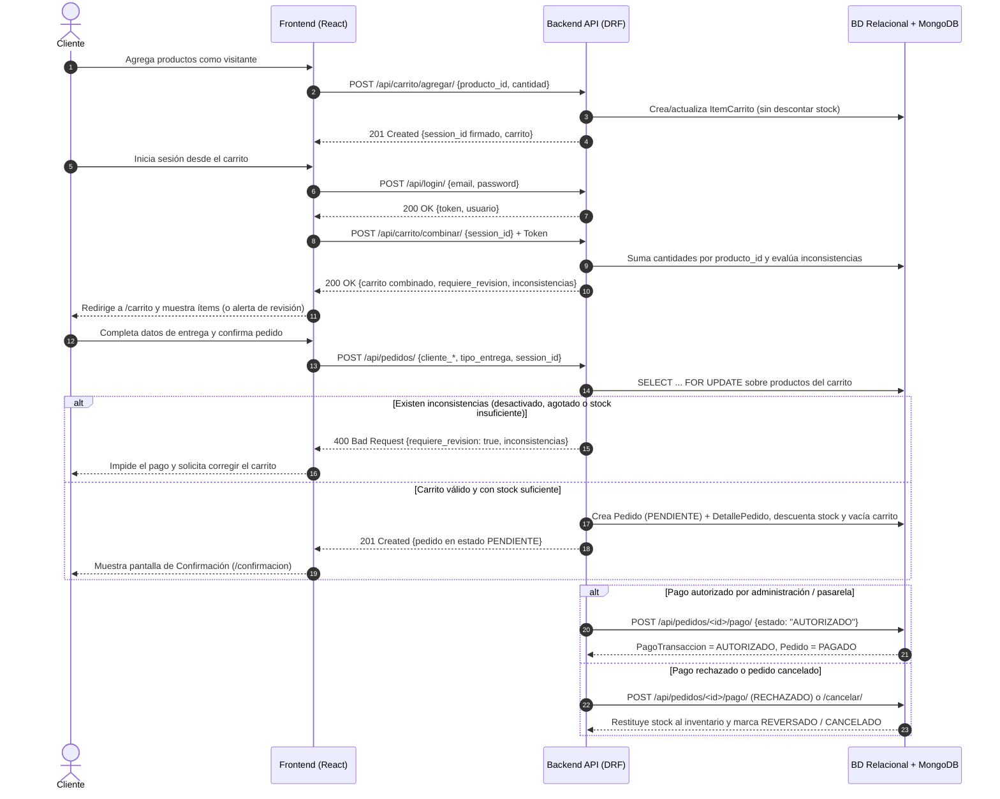

# Paraíso del Café — Solemne 2: Desarrollo de Aplicaciones Web

> **«Un sorbo al paraíso»**  
> Plataforma web integral de comercio electrónico y gestión para cafetería de especialidad, desarrollada con una arquitectura desacoplada y persistencia políglota (PostgreSQL + MongoDB Atlas).

---

## 1. Equipo, Scrum Master y Responsabilidades

| Integrante | Rol / Responsabilidad | Área Principal | Tareas Asignadas |
|---|---|---|---|
| **Patricio Chaug** | **Scrum Master (SM)** & Desarrollador Frontend | Gestión Ágil & Frontend | Coordinación de ceremonias ágiles, organización de sprints, tablero de tareas, desarrollo de componentes e interfaz en React + Vite. |
| **Javiera Fuentealba** | Desarrolladora Backend | Backend & Bases de Datos | Configuración del entorno Django, endpoints de autenticación por Token, conexión y modelos en PostgreSQL y MongoDB Atlas, e investigación de pasarela de pago en modo Sandbox. |
| **Brandon Valdés** | Desarrollador Backend | Backend & API REST | Desarrollo de endpoints RESTful, validación de datos, control de lógica de negocio y gestión de usuarios. |
| **Gabriel Moreno** | **QA & Desarrollador Backend** | QA, Backend & Seguridad | Aseguramiento de calidad (QA), validaciones de seguridad, endpoints de salud/diagnóstico de BD, manejo de estados, sesiones y despliegue del backend. |
| **Cristóbal Garrido** | Diseñador UI/UX & Desarrollador Frontend | Diseño & Frontend | Identidad corporativa, wireframes y bocetos navegables (Sprint 1), diseño de paletas temáticas y maquetación de vistas en React. |
| **José Argüello** | Desarrollador Frontend | Frontend & Integración | Implementación de vistas navegables, enrutamiento con React Router DOM, integración de componentes y consumo de la API. |

---

## 2. Contexto, Alcance y Mejoras Opcionales

### 2.1 Contexto del Negocio
**Paraíso del Café** es una tienda de café de especialidad y salón artesanal que busca digitalizar la experiencia de compra de sus clientes. La solución aborda tanto la visualización interactiva del catálogo y formatos de molienda como la gestión de pedidos, registro seguro de clientes y auditoría de transacciones.

### 2.2 Alcance del Proyecto
* **Sprint 1 (Diseño e Identidad):**
  * Definición de identidad de marca (isotipo y logotipo vectorial en SVG).
  * 4 paletas temáticas accesibles: Claro, Oscuro, Vintage y Pastel.
  * Wireframes interactivos y responsivos de 10 vistas clave (Inicio, Catálogo, Detalle, Carrito, Login, Registro, Pago, Confirmación, Contacto, Quiénes Somos).
* **Sprint 2 (Arquitectura, Backend y Base de Datos):**
  * Configuración de Backend desacoplado con **Django REST Framework (DRF)**.
  * **Persistencia Políglota**: Integración de PostgreSQL (transaccional relacional) y MongoDB Atlas (datos flexibles NoSQL).
  * Mecanismo de fallback a SQLite para desarrollo ágil sin bloqueos locales.
  * Endpoints de salud y verificación de estado en tiempo real (`/api/db-status/` y `/api/health/`).
  * Autenticación segura mediante Tokens (`/api/registro/`, `/api/login/`, `/api/logout/`) con soporte de suspensión de cuentas (`is_active`).
  * Gestión de usuarios (`/api/users/`, `/api/users/<id>/`).
  * Interfaz Frontend moderna con **React 19** y **Vite**.
  * **Investigación Técnica de Pasarela de Pagos Sandbox** ([backend/docs/2_investigacion_pasarela_pago_sandbox.md](backend/docs/2_investigacion_pasarela_pago_sandbox.md)).
* **Entrega Final (Catálogo, Carrito, Checkout, Reservas, Calidad y Despliegue):**
  * Catálogo público paginado, página de detalle con galería interactiva de múltiples imágenes (4 a 6) e imagen alternativa de respaldo.
  * Carrito anónimo con token firmado y combinación sin descarte silencioso al iniciar sesión (`POST /api/carrito/combinar/`), con retorno automático al carrito.
  * Registro y activación de cuentas mediante enlace de un solo uso con hash SHA-256 (`/api/activacion/confirmar/`).
  * Flujo de compra con reserva indivisible de stock (vigencia de 15 minutos), liberación segura e idempotente de reservas, pasarela Sandbox Webpay Plus, consolidación de `MovimientoInventario` y consulta segura del resumen de la orden.
  * Conciliación idempotente de operaciones interrumpidas, panel administrativo de incidencias y reintento de notificaciones, cobertura de pruebas del **93 %** en módulos críticos y despliegue productivo en **Vercel** y **Render**.

### 2.3 Mejoras Opcionales (Roadmap Futuro)
- [x] **Investigación de pasarela de pago en modo Sandbox:** Análisis de Transbank Webpay Plus, Mercado Pago y Stripe con guía de integración Django + DRF ([Documento Técnico](backend/docs/2_investigacion_pasarela_pago_sandbox.md)).
- [ ] Integración con pasarela de pago real (Webpay Plus / Stripe) mediante webhooks con verificación criptográfica e idempotencia.
- [ ] Sistema de reservas de mesas y programación de retiro en tienda física.
- [ ] Envío automático de boletas electrónicas y confirmación de pedidos vía correo (SMTP transaccional).
- [ ] Panel analítico para administradores con gráficos de ventas, productos favoritos y rotación de stock.
- [ ] Modo sin conexión (PWA) con caché local de catálogo para dispositivos móviles.

---

## 3. Arquitectura, Diagramas, Servicios y Datos

El sistema implementa una **arquitectura desacoplada (Decoupled Client-Server)** basada en servicios REST y persistencia políglota:

```mermaid
graph TD
    subgraph Cliente ["Capa de Presentación (Frontend)"]
        UI["React 19 + Vite SPA<br>(Puerto 5173)"]
        Design["Bocetos Sprint 1<br>(HTML/CSS Puro - Puerto 5175)"]
    end

    subgraph Servidor ["Capa de Lógica de Negocio (Backend)"]
        API["Django REST Framework API<br>(Puerto 8000)"]
        Auth["Servicio de Autenticación<br>(Tokens / Passwords Hashed)"]
        Health["Monitor de Salud & DB Status<br>(/api/db-status/)"]
    end

    subgraph Persistencia ["Capa de Persistencia Políglota"]
        Postgres[("PostgreSQL 15+<br>Datos Transaccionales, Usuarios,<br>Roles, Pedidos (ACID)")]
        Mongo[("MongoDB Atlas NoSQL<br>Auditoría de Pagos, Mensajes Contacto,<br>Atributos Dinámicos")]
        SQLite[("SQLite (db.sqlite3)<br>Fallback local de desarrollo")]
    end

    UI -->|Peticiones HTTP / JSON + Bearer Token| API
    API --> Auth
    API --> Health
    API -->|USE_POSTGRESQL=True| Postgres
    API -.->|USE_POSTGRESQL=False (Fallback)| SQLite
    API -->|PyMongo Driver| Mongo
```

### 3.1 Modelo de Datos y Distribución
* **Base de Datos Relacional (PostgreSQL / SQLite Fallback):**
  * `auth_user`: Credenciales, correo único, estado activo/suspendido (`is_active`), roles y permisos (`is_staff`).
  * `authtoken_token`: Tokens de sesión para autenticación en la API REST de Django.
  * `Categoria` (`api_categoria`): Clasificación del catálogo (Grano, Molido, Repostería, Accesorios).
  * `Producto` (`api_producto`): Catálogo comercial con precio en CLP, unidades en inventario (`stock`) y formato.
  * `Pedido` (`api_pedido`) y `DetallePedido` (`api_detallepedido`): Gestión transaccional de compras con aislamiento ACID e integridad referencial protegida (`PROTECT`).
  * `PagoTransaccion` (`api_pagotransaccion`): Registro formal de transacciones bancarias, montos y códigos de aprobación.
* **Base de Datos No Relacional (MongoDB Atlas):**
  * Colección `mensajes_contacto`: Consultas y mensajes recibidos desde el formulario de contacto web.
  * Colección `logs_pasarela_pagos`: Payloads JSON en bruto y trazas forenses de pasarelas de pago (Transbank Webpay / Stripe).
  * Colección `fichas_tecnicas_cafe`: Metadatos botánicos y sensoriales variables (notas de cata, altitud m.s.n.m., proceso, curvas de tueste).
  * Colección `resenas_productos`: Opiniones, valoraciones de 1 a 5 estrellas y feedback flexible de clientes.

---

## 4. Versiones, Compatibilidad, Prerrequisitos y Cuentas

### 4.1 Tecnologías y Versiones Obligatorias
* **Python:** `v3.10` a `v3.12+`
* **Django:** `6.1.1`
* **Django REST Framework:** `3.18.1`
* **Node.js:** `v18.x` o `v20.x` (LTS recomendado)
* **npm:** `v9.x` o superior
* **PostgreSQL:** `v14` a `v16+` (predeterminado en puerto `5432`)
* **React:** `19.2.x`
* **Vite:** `8.3.x`

### 4.2 Cuentas y Accesos Externos
1. **Cuenta en MongoDB Atlas:** Gratuita (Tier M0) para clúster en la nube.
2. **PostgreSQL Local o en Nube:** Servidor PostgreSQL local instalado o proveedor remoto (Supabase / Render / Neon).
3. **Cuenta GitHub:** Para clonar y contribuir al repositorio.

---

## 5. Instalación desde Clon Limpio y Comandos por Servicio

### 5.1 Clonar el Repositorio (Frontend)
```bash
git clone https://github.com/ReneGG/dwebs03FrontCafeinomanos.git
cd dwebs03FrontCafeinomanos
```

---

### 5.2 Configuración del Backend (Django REST Framework)

1. **Ingresar al directorio del backend:**
   ```powershell
   cd dwebs03BackendCafein-manos
   # (Si el proyecto se ejecuta desde una subcarpeta backend, ejecutar: cd backend)
   ```

2. **Crear y activar entorno virtual:**
   * En Windows (PowerShell):
     ```powershell
     python -m venv venv
     .\venv\Scripts\Activate.ps1
     ```
   * En Linux / macOS:
     ```bash
     python3 -m venv venv
     source venv/bin/activate
     ```

3. **Instalar dependencias de Python:**
   ```powershell
   pip install -r requirements.txt
   ```

4. **Configurar el archivo de entorno `.env`:**
   ```powershell
   Copy-Item .env.example .env
   # En Linux/macOS: cp .env.example .env
   ```
   *(Edita el archivo `.env` según tus credenciales de PostgreSQL y MongoDB Atlas; ver [Sección 6](#6-variables-de-entorno-sin-valores-secretos)).*

5. **Ejecutar migraciones de la base de datos:**
   ```powershell
   python manage.py makemigrations
   python manage.py migrate
   ```

6. **Iniciar el servidor de desarrollo:**
   ```powershell
   python manage.py runserver
   ```
   *El servidor quedará disponible en:* `http://localhost:8000/`

---

### 5.3 Configuración del Frontend (React + Vite)

1. **Abrir una nueva terminal y navegar a la carpeta `frontend`:**
   ```bash
   cd frontend
   ```

2. **Instalar dependencias de Node.js:**
   ```bash
   npm install
   ```

3. **Ejecutar el servidor de desarrollo:**
   ```bash
   npm run dev
   ```
   *La aplicación web estará disponible en:* `http://localhost:5173/`

4. **Comandos disponibles para Frontend:**
   | Comando | Acción |
   |---|---|
   | `npm run dev` | Inicia el servidor de desarrollo con recarga en vivo (HMR). |
   | `npm run build` | Genera los binarios optimizados de producción en la carpeta `dist/`. |
   | `npm run preview` | Previsualiza localmente la compilación de producción. |
   | `npm run lint` | Ejecuta ESLint para analizar la calidad del código. |

---

### 5.4 Previsualización de Bocetos y Diseño (Sprint 1)

Los bocetos de diseño estático no requieren instalación de dependencias de Node:
```powershell
cd diseno/sprint-1
python -m http.server 5175 --bind 127.0.0.1
```
*Abrir en el navegador:* `http://localhost:5175/index.html`

---

## 6. Variables de Entorno (Sin Valores Secretos)

El archivo `.env` reside en la raíz del proyecto backend (`dwebs03BackendCafein-manos/` o subcarpeta `backend/`) y **NUNCA** debe ser commiteado al repositorio. Utilice la siguiente plantilla (`.env.example`):

```env
# ==============================================================================
# CONFIGURACIÓN GENERAL DE DJANGO
# ==============================================================================
# Generar una clave secreta aleatoria en producción
DJANGO_SECRET_KEY=clave_secreta_de_ejemplo_cambiar_en_produccion_abcdef123456
DEBUG=True
ALLOWED_HOSTS=localhost,127.0.0.1,testserver

# ==============================================================================
# 1. BASE DE DATOS RELACIONAL: PostgreSQL (PSQL)
# ==============================================================================
# Cambiar a True para usar PostgreSQL. Si es False, usará SQLite local de respaldo.
USE_POSTGRESQL=True
DB_NAME=paraiso_cafe_db
DB_USER=postgres
DB_PASSWORD=tu_password_aqui
DB_HOST=localhost
DB_PORT=5432

# ==============================================================================
# 2. BASE DE DATOS NO RELACIONAL: MongoDB Atlas
# ==============================================================================
# Cadena de conexión obtenida en Atlas: Connect -> Drivers -> Python
MONGODB_URI=mongodb+srv://<usuario>:<password>@cluster0.xxxx.mongodb.net/?retryWrites=true&w=majority
MONGODB_DB_NAME=paraiso_cafe_nosql

# ==============================================================================
# 3. POLÍTICA DE ORÍGENES CRUZADOS (CORS) Y DESPLIEGUE
# ==============================================================================
CORS_ALLOWED_ORIGINS=http://localhost:5173,http://127.0.0.1:5173,http://localhost:3000,http://127.0.0.1:3000
FRONTEND_URL=http://localhost:5173
WEBPAY_RETURN_URL=http://localhost:5173/confirmacion
VIGENCIA_ACTIVACION_HORAS=24

# ==============================================================================
# 4. PRIMER ADMINISTRADOR AUTOMÁTICO EN DESPLIEGUE (Opcional para build.sh)
# ==============================================================================
ADMIN_USERNAME=admin
ADMIN_EMAIL=admin@paraisocafe.cl
ADMIN_PASSWORD=cambiar_por_contrasena_segura
```

Para el **Frontend** (`frontend/.env`, basado en `frontend/.env.example`):

```env
VITE_API_URL=http://localhost:8000/api
```

>Nunca comparta contraseñas ni cadenas URI de MongoDB en repositorios públicos. El archivo `.env` se encuentra explícitamente excluido mediante el `.gitignore`.

---

## 7. Datos Iniciales y Primer Administrador Seguro

### 7.1 Crear el Superusuario de Django
Para acceder al panel administrativo y gestionar usuarios o datos, ejecute de forma interactiva en la carpeta del backend (`dwebs03BackendCafein-manos`):

```powershell
python manage.py createsuperuser
```

* **Nombre de usuario / Correo:** `admin@paraisocafe.cl`
* **Contraseña segura:** Usar contraseñas que cumplan con la política de Django (mínimo 8 caracteres, alfanumérico, sin coincidencias con atributos personales).

### 7.2 Acceso al Panel Administrativo
Una vez iniciado el servidor backend, ingrese a:
* **URL:** `http://localhost:8000/admin/`
* Ingrese las credenciales creadas anteriormente.

### 7.3 Registro de Usuarios Clientes desde la API
Los usuarios estándar pueden registrarse mediante el endpoint seguro de la API:
* **POST** `/api/registro/`
* **Cuerpo JSON:**
  ```json
  {
    "email": "cliente@correo.cl",
    "password": "PasswordFuerte2026!",
    "nombre": "Ana",
    "apellido": "González"
  }
  ```
* El sistema encripta la clave mediante el algoritmo PBKDF2 con SHA-256 (estándar de Django) y retorna un Token de autenticación de respuesta inmediata.

---

## 8. Pruebas, Reportes, Estados, Reservas e Idempotencia

### 8.1 Ejecución de Pruebas Automatizadas y Cobertura (RNF-14)
* **Backend (Suite completa):**
  ```powershell
  python manage.py test api
  ```
* **Backend (Medición de cobertura excluyendo `venv/`, `migrations/`, `config/` y tests vía `.coveragerc`):**
  ```powershell
  coverage run --rcfile=.coveragerc manage.py test api.test_auth api.test_seguridad api.test_activacion api.test_reserva_indivisible api.test_liberacion_reservas api.test_confirmacion_orden api.test_conciliacion api.test_recuperacion_operaciones api.test_checkout api.test_resumen_orden api.test_carrito_combinar api.test_cobertura_modulos_criticos
  coverage report --rcfile=.coveragerc --include="*/api/permissions.py,*/api/auth_views.py,*/api/servicio_activacion.py,*/api/colecciones_mongodb/reservas.py,*/api/servicio_confirmacion.py,*/api/servicio_pasarela.py,*/api/servicio_conciliacion.py,*/api/checkout_views.py"
  ```
  * **Cobertura alcanzada en módulos críticos (autorización, reserva y confirmación):** **`93 %`** (superando el umbral mínimo del `80 %` exigido por RNF-14).
* **Reportes técnicos guardados en el repositorio Backend (`docs/`):**
  * `docs/informe_cobertura_pruebas.md` — Cobertura de pruebas por módulo crítico (`93 %`).
  * `docs/informe_pruebas_recuperacion.md` — Evidencia de recuperación ante fallos e idempotencia (HU-14 / RNF-10).
  * `docs/informe_carga_catalogo.md` — Pruebas de carga del catálogo (RNF-02 / RNF-03).
  * `docs/reporte_seguridad.md` y `docs/despliegue_y_limitaciones.md` — Auditoría de seguridad y despliegue.
* **Frontend (Linting y compilación):**
  ```bash
  npm run lint
  npm run build
  ```

### 8.2 Endpoint de Diagnóstico y Salud (`/api/db-status/`)
Permite comprobar el estado de ambas bases de datos sin requerir inicio de sesión previo:
* **GET** `http://localhost:8000/api/db-status/`
* **Respuesta Exitosa Esperada:**
  ```json
  {
    "status": "ok",
    "timestamp": "America/Santiago",
    "bases_de_datos": {
      "relacional_psql": {
        "engine": "django.db.backends.postgresql",
        "name": "paraiso_cafe_db",
        "is_postgresql": true,
        "connected": true,
        "message": "conexion exitosa a postgresql"
      },
      "no_relacional_mongodb": {
        "connected": true,
        "status": "connected",
        "database": "paraiso_cafe_nosql",
        "message": "conexion exitosa con mongodb atlas"
      }
    }
  }
  ```

### 8.3 Códigos de Estado HTTP y Manejo de Errores
| Código HTTP | Descripción | Caso de Uso en la API |
|---|---|---|
| `200 OK` | Operación exitosa | Login completado, listado de usuarios, verificación de salud. |
| `201 CREATED` | Recurso creado | Registro exitoso de nuevo cliente. |
| `400 BAD REQUEST` | Datos inválidos | Email con formato incorrecto, contraseña débil o correo ya registrado. |
| `401 UNAUTHORIZED` | No autenticado | Credenciales incorrectas o token ausente/inválido. |
| `403 FORBIDDEN` | Acceso denegado | Intento de login en cuenta con `is_active: false` (cuenta suspendida). |
| `404 NOT FOUND` | No encontrado | Usuario u objeto inexistente para edición o consulta. |

### 8.4 Reservas de Stock, Estados e Idempotencia
* **Registro de Usuarios y Activación:** Idempotente frente a reintentos; el correo se valida como único y los enlaces de activación se almacenan con hash SHA-256 para un único consumo atómico (`consumir_solicitud`).
* **Reserva Indivisible y Liberación Segura (`reservas_stock`):** Al reservar líneas de una orden se incrementa únicamente `stock_reservado` (vigencia de **15 minutos**) sin alterar `stock_fisico`. Ante pago rechazado, cancelado o vencido (siempre verificando antes el estado del pago), la liberación reduce solo `stock_reservado` de forma **idempotente** y nunca libera reservas ya consolidadas.
* **Idempotencia en Checkout, Pagos y Conciliación:**
  * `POST /api/pedidos/` acepta `operacion_id` o cabecera `Idempotency-Key` para devolver la misma orden ante reintentos o doble clic sin duplicar descuentos de stock.
  * `POST /api/pedidos/<id>/pago/iniciar/` reutiliza intentos `INICIADO` activos, y `POST /api/pedidos/<id>/pago/retorno/` es idempotente ante confirmaciones repetidas.
  * La conciliación (`/api/admin/conciliacion/`) recupera órdenes interrumpidas (`PENDIENTE`, `CONFIRMACION_PENDIENTE`, `REVISION_REQUERIDA`) y no duplica efectos al ejecutarse repetidamente.

### 8.5 Contratos del Flujo de Compra (Checkout, Orden, Reserva y Pago — HU-18 / RNF-05)

El flujo de compra abarca desde la gestión del carrito (anónimo o autenticado) y su combinación al iniciar sesión, hasta la confirmación del pedido con reserva transaccional de stock y el registro o cancelación del pago.

#### 1. Resumen de Endpoints del Flujo de Compra

| Fase | Método y Ruta | Permisos | Propósito |
|---|---|---|---|
| **Carrito** | `GET /api/carrito/?session_id=<token>` | Público / Token opcional | Obtiene el carrito activo, totales y posibles inconsistencias de stock o disponibilidad. |
| **Carrito** | `POST /api/carrito/agregar/` | Público / Token opcional | Agrega unidades de un producto al carrito (sin descontar inventario en esta etapa). |
| **Carrito** | `PATCH /api/carrito/actualizar/<item_id>/` | Público / Token opcional | Actualiza la cantidad de una línea del carrito validando el stock disponible. |
| **Carrito** | `DELETE /api/carrito/eliminar/<item_id>/` | Público / Token opcional | Elimina una línea del carrito (devuelve stock solo si era una línea heredada con reserva previa). |
| **Combinación** | `POST /api/carrito/combinar/` | `IsAuthenticated` (Token) | Fusiona el carrito anónimo con el del cliente por `producto_id`, sumando cantidades sin descartar ítems. |
| **Checkout / Orden y Reserva** | `POST /api/pedidos/` | Público / Token opcional | Valida inconsistencias, crea la orden (`PENDIENTE`), **reserva/descuenta el stock de forma atómica** y vacía el carrito. |
| **Orden** | `GET /api/pedidos/listado/` | `IsAuthenticated` (Token) | Lista todas las órdenes (administrador) o las órdenes asociadas al correo del cliente autenticado. |
| **Orden** | `GET /api/pedidos/<pedido_id>/` | `IsAuthenticated` (Token) | Obtiene el detalle de una orden, sus líneas (`detalles`) y su transacción de pago (`pago`). |
| **Pago** | `POST /api/pedidos/<pedido_id>/pago/` | `EsAdministrador` | Registra el resultado del pago (`AUTORIZADO` o `RECHAZADO`). Si es rechazado, revierte la reserva de stock. |
| **Cancelación** | `POST /api/pedidos/<pedido_id>/cancelar/` | `EsAdministrador` | Cancela una orden `PENDIENTE` o `PAGADO`, devuelve el stock reservado al inventario y reversa el pago si aplica. |

#### 2. Contratos Detallados: Entrada, Respuestas y Errores

##### A. Consultar y Combinar Carrito (`GET /api/carrito/` y `POST /api/carrito/combinar/`)
* **Entrada (`POST /api/carrito/combinar/`):**
  ```json
  {
    "session_id": "token_firmado_del_carrito_anonimo"
  }
  ```
* **Respuesta exitosa (`200 OK`):**
  ```json
  {
    "status": "success",
    "message": "Carritos combinados correctamente.",
    "combinado": true,
    "productos_combinados": 2,
    "session_id": "nuevo_token_firmado",
    "requiere_revision": false,
    "puede_pagar": true,
    "inconsistencias": [],
    "carrito": {
      "id": "b3c8f1a2-...",
      "session_id": "nuevo_token_firmado",
      "items": [
        {
          "id": 12,
          "producto_id": 1,
          "nombre": "Capuccino",
          "precio_unitario": 3800,
          "cantidad": 2,
          "subtotal": 7600,
          "imagen_url": "https://...",
          "stock": 15,
          "disponible": true
        }
      ],
      "total_unidades": 2,
      "total": 7600,
      "inconsistencias": [],
      "requiere_revision": false,
      "puede_pagar": true
    }
  }
  ```
* **Detección de inconsistencias (sin descarte silencioso):** Si tras combinar o consultar el carrito hay productos desactivados (`disponible: false`), agotados (`stock: 0`) o cuya cantidad supera el stock (`cantidad > stock`), el backend conserva todas las líneas intactas y devuelve `requiere_revision: true`, `puede_pagar: false` y el detalle en `inconsistencias` (`motivo`: `"desactivado"`, `"agotado"` o `"stock_insuficiente"`).
* **Errores:** `401 Unauthorized` si se llama a `/api/carrito/combinar/` sin token válido.

##### B. Agregar, Actualizar y Eliminar del Carrito
* **`POST /api/carrito/agregar/`**
  * **Entrada:** `{ "producto_id": 1, "cantidad": 2, "session_id": "<opcional>" }`
  * **Respuesta:** `201 Created` (línea nueva) o `200 OK` (suma a línea existente) con `{ "status": "success", "session_id": "...", "carrito": { ... } }`.
  * **Errores (`400 Bad Request`):** Producto inexistente, inactivo (`disponible: false`), agotado (`stock <= 0`), cantidad no entera o superior al stock disponible.
* **`PATCH /api/carrito/actualizar/<item_id>/`**
  * **Entrada:** `{ "cantidad": 3, "session_id": "<opcional>" }`
  * **Respuesta (`200 OK`):** Carrito actualizado.
  * **Errores:** `400 Bad Request` (cantidad `<= 0` o mayor al stock disponible), `404 Not Found` (carrito o línea inexistente).
* **`DELETE /api/carrito/eliminar/<item_id>/`**
  * **Entrada:** `{ "session_id": "<opcional>" }`
  * **Respuesta (`200 OK`):** `{ "status": "success", "stock_devuelto": false, "carrito": { ... } }`.
  * **Errores:** `404 Not Found` (no hay carrito activo o el ítem no pertenece al carrito).

##### C. Confirmar Checkout, Crear Orden y Reservar Stock (`POST /api/pedidos/`)
* **Entrada:**
  ```json
  {
    "session_id": "token_firmado_del_carrito",
    "cliente_nombre": "Beatriz Pinzón",
    "cliente_email": "cliente@ejemplo.cl",
    "cliente_telefono": "+56912345678",
    "tipo_entrega": "despacho",
    "direccion_entrega": "Av. Providencia 1234, Providencia",
    "notas": "Medio de pago solicitado: tarjeta. Sin datos de tarjeta."
  }
  ```
  *(Nota: `tipo_entrega` acepta `"retiro"` o `"despacho"`. Si es `"despacho"`, `direccion_entrega` es obligatoria).*
* **Respuesta exitosa (`201 Created`):**
  ```json
  {
    "status": "success",
    "message": "Pedido creado correctamente.",
    "session_id": "token_firmado",
    "pedido": {
      "id": 1,
      "cliente_nombre": "Beatriz Pinzón",
      "cliente_email": "cliente@ejemplo.cl",
      "tipo_entrega": "despacho",
      "direccion_entrega": "Av. Providencia 1234, Providencia",
      "subtotal": "7600.00",
      "costo_envio": "0.00",
      "total": "7600.00",
      "estado": "PENDIENTE",
      "detalles": [
        {
          "id": 1,
          "producto_id": 1,
          "producto_nombre": "Capuccino",
          "cantidad": 2,
          "precio_unitario": "3800.00",
          "subtotal": "7600.00"
        }
      ],
      "pago": null
    }
  }
  ```
* **Errores (`400 Bad Request`):**
  * Datos de cliente inválidos o dirección faltante en despacho (`errores` por campo).
  * Carrito inexistente o vacío.
  * **Bloqueo por inconsistencias:** Si cualquier producto del carrito está desactivado, agotado o sin stock suficiente, la transacción se aborta sin descontar stock ni vaciar el carrito, devolviendo:
    ```json
    {
      "status": "error",
      "message": "No se puede continuar con el pago mientras existan productos que requieren revisión.",
      "requiere_revision": true,
      "puede_pagar": false,
      "inconsistencias": [
        {
          "item_id": 12,
          "producto_id": 1,
          "nombre": "Capuccino",
          "motivo": "stock_insuficiente",
          "mensaje": "'Capuccino' solo tiene 5 unidades disponibles y tu carrito solicita 7.",
          "cantidad_en_carrito": 7,
          "stock_disponible": 5,
          "disponible": true
        }
      ]
    }
    ```

##### D. Consultar Órdenes (`GET /api/pedidos/listado/` y `GET /api/pedidos/<pedido_id>/`)
* **Respuesta exitosa (`200 OK`):** Devuelve la lista de pedidos o el objeto `pedido` con sus `detalles` y `pago`.
* **Errores:** `401 Unauthorized` (sin token), `403 Forbidden` (cliente intentando ver el pedido de otro correo), `404 Not Found` (pedido inexistente).

##### E. Registrar Pago (`POST /api/pedidos/<pedido_id>/pago/`)
* **Entrada:**
  ```json
  {
    "estado": "AUTORIZADO",
    "transaccion_id_externo": "TBK-987654",
    "codigo_autorizacion": "1213"
  }
  ```
  *(El campo `estado` acepta `"AUTORIZADO"` o `"RECHAZADO"`).*
* **Respuesta exitosa (`200 OK`):** `{ "status": "success", "message": "Pago registrado correctamente.", "pedido": { ... } }`.
* **Errores:** `400 Bad Request` (estado inválido o el pedido ya está en `CANCELADO` / `ENTREGADO`), `403 Forbidden` (no es administrador), `404 Not Found` (pedido inexistente).

##### F. Cancelar Orden y Liberar Reserva (`POST /api/pedidos/<pedido_id>/cancelar/`)
* **Entrada:** Sin cuerpo obligatorio.
* **Respuesta exitosa (`200 OK`):** `{ "status": "success", "message": "Pedido cancelado y stock devuelto.", "pedido": { ... } }`.
* **Errores:** `400 Bad Request` (solo se pueden cancelar pedidos en estado `PENDIENTE` o `PAGADO`), `403 Forbidden` (no es administrador), `404 Not Found` (pedido inexistente).

#### 3. Estados de la Orden (`Pedido`) y de la Transacción (`PagoTransaccion`)

| Estado de la Orden (`Pedido.estado`) | Cuándo se asigna / cambia | Efecto sobre el inventario (Stock) |
|---|---|---|
| **`PENDIENTE`** | 1. Al confirmar el checkout (`POST /api/pedidos/`).<br>2. Si el pago se registra como `RECHAZADO` (`POST /api/pedidos/<id>/pago/`). | 1. Al crear la orden, se bloquean los productos (`SELECT ... FOR UPDATE`) y **se descuenta/reserva el stock**.<br>2. Si el pago es `RECHAZADO`, **se devuelve el stock reservado** al inventario y el producto vuelve a `disponible = True`. |
| **`PAGADO`** | Al registrar un pago con `estado: "AUTORIZADO"` en `POST /api/pedidos/<id>/pago/`. | Mantiene el stock ya reservado al crear el pedido. La transacción pasa a `AUTORIZADO`. |
| **`PREPARANDO`** | Cuando la cafetería inicia la preparación de un pedido pagado (actualización administrativa). | Sin cambios de stock. |
| **`LISTO`** | Cuando el pedido está terminado y listo para retiro en local o despacho a domicilio. | Sin cambios de stock. |
| **`ENTREGADO`** | Estado final cuando el cliente recibe su pedido. No admite nuevos cambios de pago ni cancelación. | Venta consolidada definitivamente. |
| **`CANCELADO`** | Al ejecutar `POST /api/pedidos/<id>/cancelar/` sobre un pedido `PENDIENTE` o `PAGADO`. | **Restituye íntegramente el stock** de cada `DetallePedido` al inventario (`disponible = True`). Si tenía un pago `AUTORIZADO`, la transacción pasa a **`REVERSADO`**. |

#### 4. Diagrama de Secuencia del Flujo de Compra



---

## 9. URLs, Plataformas, Cuotas y Persistencia

### 9.1 Tabla de URLs del Proyecto (Local y Despliegue)
| Servicio / Módulo | URL Local | URL de Producción (Despliegue) | Descripción |
|---|---|---|---|
| **Frontend Web (Vercel)** | `http://localhost:5173/` | `https://cafeinomanos.vercel.app/` | Aplicación SPA principal en React + Vite. |
| **API Backend (Render)** | `http://localhost:8000/api/` | `https://dwebs03backendcafein-manos.onrender.com/api/` | Raíz de servicios RESTful en Django REST Framework. |
| **Diagnóstico DB** | `http://localhost:8000/api/db-status/` | `https://dwebs03backendcafein-manos.onrender.com/api/db-status/` | Chequeo de conexión PostgreSQL/SQLite y MongoDB Atlas. |
| **Test Endpoint** | `http://localhost:8000/api/test/` | `https://dwebs03backendcafein-manos.onrender.com/api/test/` | Comprobación rápida de respuesta backend. |
| **Panel Admin Django** | `http://localhost:8000/admin/` | `https://dwebs03backendcafein-manos.onrender.com/admin/` | Panel de gestión administrativa de Django. |
| **Bocetos Sprint 1** | `http://localhost:5175/` | — | Presentación estática de temas e identidad. |

### 9.2 Plataformas de Despliegue Sugeridas
* **Frontend:** Vercel, conectado al repositorio `JoseArguello2101/cafeinomanos-frontend`. Cada push o merge a `master` se publica solo en `https://cafeinomanos.vercel.app/` (en Vercel el Root Directory es `frontend`).
  * La variable `VITE_API_URL` está configurada en Vercel (Settings → Environment Variables) con la URL del backend terminada en `/api`. Si se cambia, hay que volver a desplegar desde la pestaña Deployments.
  * El archivo `frontend/vercel.json` envía todas las rutas a `index.html`, así recargar `/catalogo` u otra página no da 404.
* **Backend:** Render o Railway (entorno Linux con Gunicorn / Uvicorn).
* **Bases de Datos:**
  * **PostgreSQL:** Neon / Supabase / Render PostgreSQL.
  * **MongoDB:** MongoDB Atlas (AWS sa-east-1 São Paulo).

### 9.3 Cuotas y Restricciones (Free Tier)
* **MongoDB Atlas (M0 Shared):** Almacenamiento máximo de 512 MB, hasta 500 conexiones simultáneas. Tiempo de espera de conexión configurado a `serverSelectionTimeoutMS=4000` para evitar bloqueos si la red presenta latencia.
* **PostgreSQL (Local / Cloud Free):** Límite típico de conexiones concurrentes (20 a 100 conexiones).

---

## 10. Logs, Reintentos, Respaldos y Recuperación

### 10.1 Gestión de Logs y Diagnóstico
* Los errores de conexión de la base de datos se registran en la consola del servidor backend detallando la excepción.
* Monitoreo de latencia y estado a través del endpoint `/api/db-status/`.

### 10.2 Resiliencia y Fallback Automático
* **Mecanismo de Respaldo Local:** Si el servidor PostgreSQL del desarrollador no está activo o se trabaja sin conexión, basta con configurar `USE_POSTGRESQL=False` en el `.env` para que el sistema opere inmediatamente sobre `SQLite` (`db.sqlite3`).
* **Timeout en MongoDB:** Cliente singleton configurado con tiempo máximo de espera de 4 segundos para evitar que la aplicación quede bloqueada ante caídas del clúster remoto.

### 10.3 Políticas de Respaldos (Backup) y Restauración (Restore)

#### Respaldo de PostgreSQL:
```bash
# Exportar dump de la base de datos:
pg_dump -U postgres -h localhost paraiso_cafe_db > respaldo_paraiso_cafe.sql

# Restaurar en caso de contingencia:
psql -U postgres -h localhost -d paraiso_cafe_db < respaldo_paraiso_cafe.sql
```

#### Respaldo de MongoDB Atlas:
```bash
# Exportar colecciones con mongodump:
mongodump --uri="<TU_MONGODB_URI>" --out=./backup_mongo/

# Restaurar datos:
mongorestore --uri="<TU_MONGODB_URI>" ./backup_mongo/
```

---

## 11. Trazabilidad, Contribuciones y Limitaciones Conocidas

### 11.1 Flujo de Trabajo Git (Git Flow)
* `main`: Código estable probado y listo para entrega.
* `develop`: Integración de características del sprint en curso.
* `feature/<nombre>`: Ramas específicas para el desarrollo de módulos o endpoints.
* **Convención de Commits (Conventional Commits):**
  * `feat: ...` Nueva funcionalidad.
  * `fix: ...` Corrección de errores.
  * `docs: ...` Modificaciones en documentación o comentarios.
  * `style: ...` Ajustes visuales, CSS o formateo sin cambios en lógica.
  * `refactor: ...` Reestructuración de código sin alterar su comportamiento externo.

### 11.2 Limitaciones Conocidas
1. **Pasarela de Pagos Sandbox:** La integración con Webpay Plus opera en modo Sandbox controlado por el backend (sin cobros bancarios reales ni almacenamiento de datos de tarjetas).
2. **Arranque en Frío (Render Free Tier):** El backend desplegado en Render puede demorar entre 30 y 50 segundos en responder la primera solicitud tras un período de inactividad.
3. **Envío de Correos:** Por defecto opera con `ConsoleEmailBackend` y persistencia auditable en `RegistroNotificacion`, permitiendo reintentos manuales desde el panel administrativo (`/admin/notificaciones`) si no se configura un servidor SMTP externo.
4. **Cuentas Suspendidas:** La suspensión de cuentas opera a nivel de backend validando `is_active=False` al iniciar sesión y en cualquier endpoint protegido (`CuentaActiva`).

---

## 12. Procedencia y Licencias de Recursos

* **Recursos Gráficos y Multimedia:**
  * Logotipo e Isotipo (`logotipo.svg`, `simbolo.svg`): Creación original del equipo de diseño del proyecto bajo autoría de Cristóbal Garrido.
* **Tipografías:**
  * `Georgia` (Web-safe Serif) y `Trebuchet MS` (Web-safe Sans-Serif).
* **Licencias de Software:**
  * **Django:** Licencia BSD de 3 cláusulas.
  * **Django REST Framework:** Licencia Encode OSS.
  * **React & Vite:** Licencia MIT.
  * **PyMongo & Psycopg2:** Licencia Apache 2.0 / LGPL con excepciones.
* **Licencia del Repositorio:**
  * Proyecto académico bajo **Licencia MIT**. Consulte el repositorio para más detalles.
